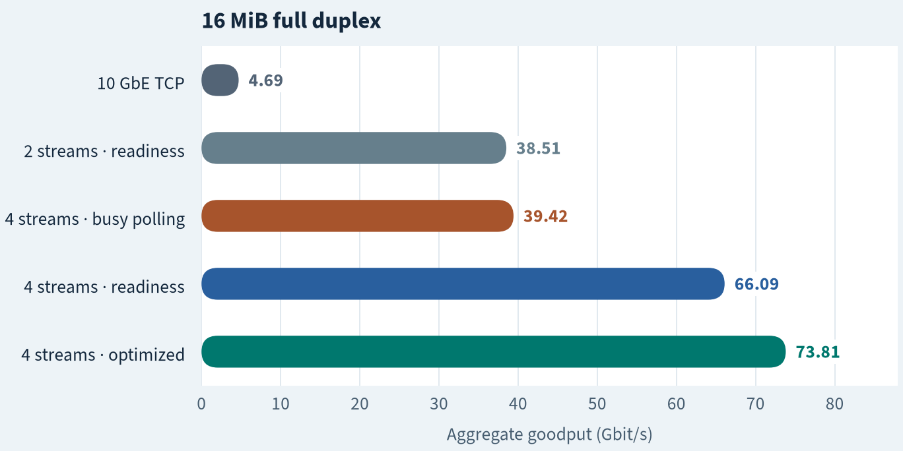

# usb4-rdma

Connect Linux hosts over direct USB4 cables, with one daemon per host.
Use Rust for remote memory, libfabric for MPI, or the NCCL/RCCL and ggml-rpc plugins for distributed model workloads.

[Connect two hosts](docs/QUICKSTART.md) · [Benchmark results](benchmarks/README.md) · [Release build](docs/RELEASE.md)

## Published 0.1 baseline

Two FEVM FAEX1 hosts (Ryzen AI Max+ 395 / Radeon 8060S), two 40 Gbit/s USB4
cables, and 10 GbE TCP. Release tests used Fedora Linux 44 Server and
Ubuntu 26.04.1 LTS. [Test devices and kernels](docs/QUALIFICATION.md#test-devices)

| Workload | 10 GbE | Dual USB4 |
| --- | ---: | ---: |
| 16 MiB full-duplex RDMA write (4 streams, `--backend usb4-busy-poll`) | 4.69 Gbit/s | **73.81 Gbit/s** (74.17 paired) |
| 16 MiB unidirectional RDMA write / read (4 streams) | 9.39 Gbit/s | **41.92 / 42.20 Gbit/s** |
| 64 B host RDMA write / read p50 | 33.8 µs (ping-pong) | **13.6 / 13.1 µs** |
| 1 MiB host `f32` SUM AllReduce p50 (algbw) | 3,609 µs (0.29 GB/s) | **293.9 µs (3.55 GB/s)** |
| 64 MiB Open MPI one-way goodput | 9.40 Gbit/s | **12.04 Gbit/s** |
| 16 MiB RCCL BF16 AllReduce p50 | 16.11 ms | **10.78 ms** |
| Qwen Flash Next TP=2 (`1,024` tokens, `c=4`) TTFT / throughput | 5.90 s / 15.43 tok/s | **2.67 s / 23.94 tok/s** |

[One-way writes](benchmarks/results/roofline-write.png) ·
[Latency comparison](benchmarks/results/roofline-latency.png) ·
[MPI results](benchmarks/README.md#native-mpi) ·
[RCCL results](benchmarks/README.md#rocm-rccl) ·
[Inference results](benchmarks/README.md#two-host-rocm-inference)

## Quick start

Use Linux kernels with USB4STREAM and ConfigFS support.
Check both hosts with `usb4-rdma-ctl doctor`. Follow the [USB4 setup guide](docs/QUICKSTART.md),
then use the [Open MPI guide](docs/MPI.md) or the [ROCm and inference guide](docs/ROCM.md).

## Support

| Interface | Release scope |
| --- | --- |
| Rust | Tagged send/receive, registered host memory, and one-sided reads and writes |
| Libfabric | RDM host messages, tags, and manual-progress host RMA. |
| Collective plugins | NCCL and RCCL net v12 with host staging. |
| ggml-rpc | Transactional C byte stream. See [llama.cpp integration](adapters/llama-rpc/README.md). |
| Transport | Linux USB4STREAM, direct cables, and bonded links. The daemon stages data through host memory. |

[Rust crate guide](crates/README.md)

The [roadmap](docs/ROADMAP.md) tracks verbs, MPI one-sided windows, UCX, GPU-aware
MPI, and direct GPU DMA.

[Architecture](docs/ARCHITECTURE.md) · [Release qualification](docs/QUALIFICATION.md) ·
[Contributing](CONTRIBUTING.md) · [Security](SECURITY.md) · [MIT](LICENSE)
